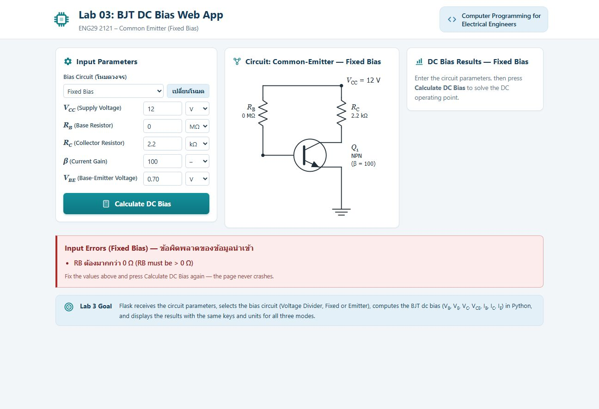
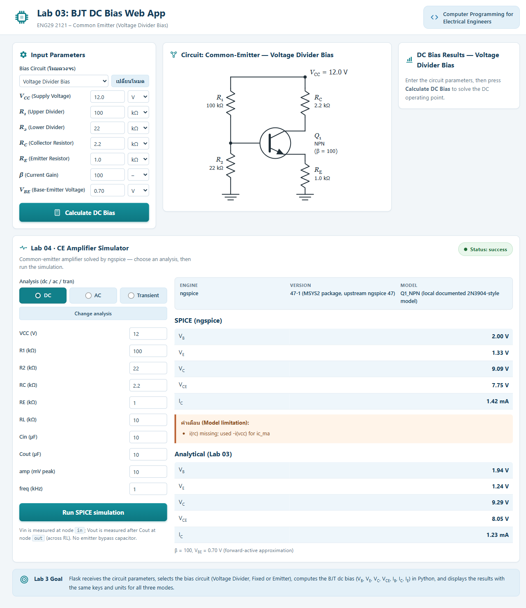
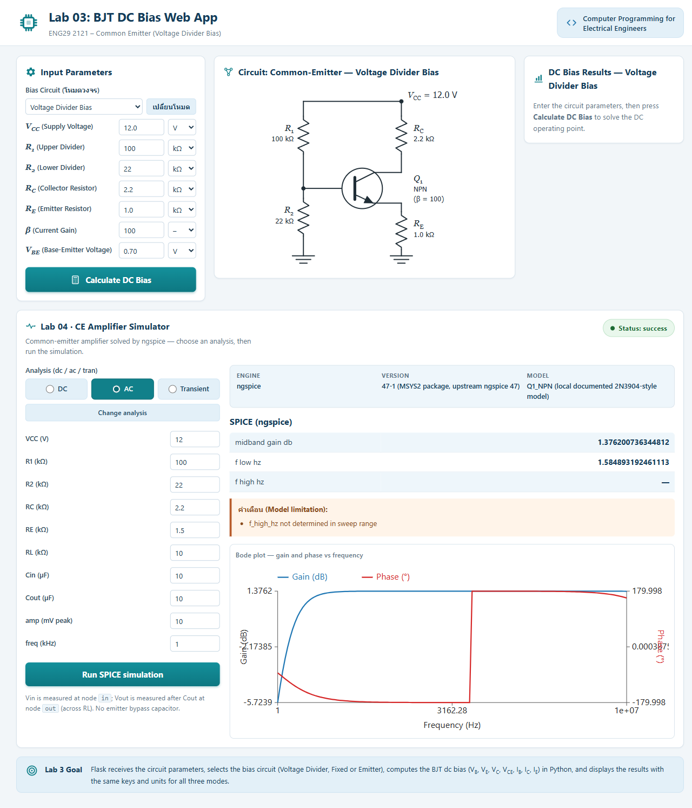
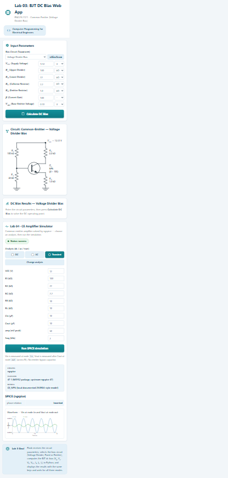

# BJT DC Bias Web App — ENG29 2121 Lab 03

Flask Web Application สำหรับคำนวณ **DC Operating Point** ของวงจรขยาย BJT Common-Emitter
แบบเลือกได้ 3 โหมด: **Voltage Divider Bias**, **Fixed Bias** และ **Emitter Bias**
(แหล่งจ่ายเดียว) ใช้ Forward-Active Approximation (β คงที่, VBE คงที่)
การคำนวณทั้งหมดอยู่ใน Python Backend (`dc_bias.py`) ไม่มีสมการใน HTML/JavaScript

Lab 02 เดิม (Voltage Divider) ยังให้ผลเหมือนเดิมสำหรับอินพุตชุดเดิม และชุดทดสอบเดิมยังผ่านทุกตัว

## โครงสร้างโปรเจกต์

```
transistor-simulator/
├── app.py                  # Flask routes: GET / , POST /calculate (เลือก solver ตามโหมด)
├── dc_bias.py              # โมดูลคำนวณวิศวกรรม (ไม่รู้จัก HTTP/HTML)
├── templates/index.html    # ฟอร์ม + ผลลัพธ์ (Jinja) แสดงเฉพาะช่องของโหมดที่เลือก
├── static/style.css        # การแสดงผล
├── tests/
│   ├── test_dc_bias.py     # unit tests (สมการ + validation ทุกโหมด)
│   └── test_web.py         # HTTP tests ผ่าน Flask test client
├── docs/
│   ├── validation.md             # ตาราง A1–A5 จากการตรวจผ่าน Browser จริง
│   └── validation-a5-error.jpeg  # หลักฐาน screenshot กรณี A5
├── requirements.txt
└── README.md
```

## การติดตั้งและรัน

```powershell
python -m venv .venv
.venv\Scripts\Activate.ps1        # Windows PowerShell
# source .venv/bin/activate       # Linux / macOS
python -m pip install -r requirements.txt
python -m flask --app app run
```

เปิด Browser ที่ **http://127.0.0.1:5000/**
(ต้องรันผ่าน Flask server เท่านั้น — เปิด `templates/index.html` ตรง ๆ ด้วย `file://` ไม่ได้
เพราะการคำนวณเกิดที่ Python Backend)

ในฟอร์ม:

1. เลือก **Bias mode** (Voltage Divider / Fixed / Emitter) แล้วกด **เปลี่ยนโหมด**
   — หน้าจะโหลดใหม่และแสดงเฉพาะช่องที่โหมดนั้นใช้
2. กรอกค่าตามหน่วยที่แสดงข้างช่อง (Ω / kΩ / MΩ แปลงเป็น Ω ครั้งเดียวที่ `app.py`)
3. กด **Calculate DC Bias** — ผล/error จะระบุชื่อโหมดที่เลือกเสมอ และผลเก่าจะไม่หลงเหลือเมื่ออินพุตผิด

## การรัน Automated Tests

```powershell
.\.venv\Scripts\python.exe -m unittest discover -s tests -v
```

ผลล่าสุด: **OK 96/96** (`.\.venv\Scripts\python.exe -m unittest discover -s tests -v`)
— tests เดิม Lab 02/03 ยังอยู่ครบ + tests ใหม่ของ Lab 04

## สามโหมดและสมการที่ใช้

ทุกโหมดรับ `VCC, RC, β, VBE` เหมือนกัน ต่างกันที่ตัวต้านทานและสมการ IB

| โหมด | ช่องที่ใช้ | IB |
|---|---|---|
| Voltage Divider Bias | R1, R2, RC, RE | `(VTH − VBE) / [RTH + (β+1)·RE]` |
| Fixed Bias | RB, RC | `(VCC − VBE) / RB` |
| Emitter Bias | RB, RC, RE | `(VCC − VBE) / [RB + (β+1)·RE]` |

โดย `VTH = VCC·R2/(R1+R2)` และ `RTH = R1·R2/(R1+R2)` (เฉพาะ Divider)

ค่าที่ตามมาจาก IB (helper ร่วม `_finish` ใน `dc_bias.py`):

```
IC = β·IB        IE = (β+1)·IB
VE = IE·RE       (Fixed Bias ใช้ VE = 0 V)
VB = VE + VBE
VC = VCC − IC·RC
VCE = VC − VE
```

หน่วยที่ส่งกลับเหมือนทุกโหมด: `vb, ve, vc, vce` เป็น **V**, `ic_ma` เป็น **mA**,
`ib_ua` เป็น **µA**, `ie_ma` เป็น **mA** (ใช้ `BiasResult` ตัวเดียวทั้ง 3 โหมด)

## ค่าอ้างอิงอิสระ (คำนวณมือ ไม่ได้อ่านจากโปรแกรม)

ใช้ชุดเดียวกับใบงาน: VCC=12 V, RC=2.2 kΩ, β=100, VBE=0.70 V

| กรณี | อินพุตเพิ่ม | IC อ้างอิง | VCE อ้างอิง |
|---|---|---|---|
| Divider (Lab 02) | R1=100 kΩ, R2=22 kΩ, RE=1 kΩ | 1.2299 mA | 8.0522 V |
| Fixed | RB=1 MΩ | 1.1300 mA | 9.5140 V |
| Emitter | RB=1 MΩ, RE=1 kΩ | 1.0263 mA | 8.7054 V |
| Emitter | RB=1 MΩ, RE=2 kΩ | 0.9401 mA | 8.0328 V |

## ผลตรวจ A1–A5 ผ่าน Browser จริง

ตรวจวันที่ 2026-11-17 ที่ `http://127.0.0.1:5000/` โดยกรอกฟอร์มจริง + กด **Calculate DC Bias** ทุกกรณี
ค่าร่วมทุกกรณี: **VCC = 12 V, RC = 2.2 kΩ, β = 100, VBE = 0.70 V**
เกณฑ์: |ΔIC| ≤ 0.01 mA, |ΔVCE| ≤ 0.02 V (เทียบค่าอ้างอิงที่ยังไม่ปัดเศษ)

| Case | อินพุต (หน่วย) | ค่าคาดหมาย | ผลจริง | วิธีตรวจ | สถานะ | หลักฐานจากหน้าเว็บ |
|---|---|---|---|---|---|---|
| A1 | Divider · R1=100 kΩ, R2=22 kΩ, RE=1 kΩ | IC 1.2299 mA · VCE 8.0522 V | **IC 1.23 mA · VCE 8.05 V** | OpenCode Browser | PASS | `DC Bias Results — Voltage Divider Bias`; แถว `IC 1.23 mA`, `VCE 8.05 V` — ตรงกับผล Lab 02 เดิม |
| A2 | Fixed · RB=1 MΩ (ไม่มีช่อง R1/R2/RE) | IC 1.1300 mA · VCE 9.5140 V | **IC 1.13 mA · VCE 9.51 V** | OpenCode Browser | PASS | `DC Bias Results — Fixed Bias`; แถว `IC 1.13 mA`, `VCE 9.51 V`; `Active region approximation OK` |
| A3 | Emitter · RB=1 MΩ, RE=1 kΩ | IC 1.0263 mA · VCE 8.7054 V | **IC 1.03 mA · VCE 8.71 V** | OpenCode Browser | PASS | `DC Bias Results — Emitter Bias`; แถว `IC 1.03 mA`, `VCE 8.71 V` |
| A4 | Emitter · เปลี่ยนเฉพาะ RE เป็น 2 kΩ | IC 0.9401 mA · VCE 8.0328 V (ต้อง **ลด** จาก A3) | **IC 0.94 mA · VCE 8.03 V** | OpenCode Browser | PASS | ก่อน `1.03 mA`/`8.71 V` → หลัง `0.94 mA`/`8.03 V`; ฟอร์มยืนยัน `re=2`, `re_unit=kohm`, โหมดยังเป็น `emitter` |
| A5 | Fixed · RB=0 | error ระบุ RB, เว็บไม่ล่ม, ไม่แสดงผลรอบก่อน | **error `RB ต้องมากกว่า 0 Ω (RB must be > 0 Ω)`**; ไม่มีตารางผล; ไม่มี `0.94 mA` ค้าง | OpenCode Browser | PASS | `Input Errors (Fixed Bias) — ข้อผิดพลาดของข้อมูลนำเข้า`; ข้อความมาจาก **Flask** ไม่ใช่ HTML `required` |

**เหตุผลเปลี่ยนเครื่องมือ:** ใบงานระบุ Playwright MCP แต่ไม่ได้ configure ใน session นี้ จึงใช้
**OpenCode Browser** (`tools.browser.*` — Chromium ใน OpenCode Desktop) แทน ซึ่งเป็นวิธีสำรองที่ใบงานอนุญาต
ทุกกรณีกรอกผ่านฟอร์มจริงใน browser + กดปุ่มจริง ไม่ใช้ curl หรืออ่าน source แทน

**หลักฐานภาพหน้าจอ (กรณี A5):**



**A3 → A4:** เพิ่ม RE ทำให้ตัวหาร `RB+(β+1)·RE` เพิ่มจาก 1.101 MΩ → 1.202 MΩ
IB ลด 10.2634 → 9.4010 µA → IC ลด 1.03 → 0.94 mA ตามที่ทำนายไว้ล่วงหน้า

รายละเอียดเต็ม (รวมสมการอ้างอิงอิสระ): [`docs/validation.md`](docs/validation.md)

## ข้อจำกัดของแบบจำลอง (Model Limitations)

- ใช้ Forward-Active Approximation เท่านั้น (β, VBE คงที่) — ไม่ใช่ SPICE,
  ไม่ทำ DC Load Line / AC / Transient / bypass capacitor
- แยกแยะ "อินพุตผิด" กับ "แบบจำลองใช้ไม่ได้":
  - ข้อมูลไม่ครบ / ไม่ใช่ตัวเลข / ไม่จำกัด (`nan`, `inf`) / ค่าที่ต้องเป็นบวก ≤ 0 → **Error** (ไม่แสดงผล)
  - IB ≤ 0 หรือ VCE ≤ 0.2 V (โหมดใหม่) → **warning** ว่าแบบจำลอง Forward-Active อาจใช้ไม่ได้
    (ไม่พยายามหาค่าจริงใน Cutoff/Saturation)
- โหมดที่ไม่รู้จัก → แจ้ง error ทันที ไม่เดาเป็น Divider

## ใครทำอะไร (AI-assisted lab)

- **AI เขียนโค้ด**: `dc_bias.py` (Fixed/Emitter solvers + mode validation), `app.py`
  (dispatch ตามโหมด + แปลงหน่วยเฉพาะช่องที่ใช้), `templates/index.html` + `static/style.css`
  (mode selector, conditional fields), README และ `docs/validation.md`
- **สิ่งที่ต้องตรวจด้วยความเข้าใจ**: สมการ IB ของแต่ละโหมด, การแปลง kΩ/MΩ → Ω
  (จุดเดียวใน `app.py`), ชื่อคีย์/หน่วยของ `BiasResult`, ข้อความ error/warning,
  และค่าอ้างอิงอิสระในตารางข้างบน
- จุดเลือกฟังก์ชันอยู่ที่ `app.py` → `SOLVERS[mode](bias)`; แปลงหน่วยอยู่ที่ลูป
  `RESISTOR_FIELDS_BY_MODE[mode]` ใน `calculate()`
- สมการแต่ละอันถูกเทียบกับโค้ด AI แล้ว (ตารางเทียบสมการ + หน่วย + dict: [`docs/validation.md`](docs/validation.md))

## ส่งงาน / Reproduce

**GitHub:** https://github.com/Poowadech1803/Gitlab (branch `main`, ตรงกับ local แล้ว)

Commit SHA ของงาน Lab 03 (base `b567473`):

| SHA | สิ่งที่ทำ |
|---|---|
| `387dfeb` | `feat(dc_bias)`: solver 3 โหมด + validation |
| `f6d67da` | `feat(web)`: dispatch ตาม mode |
| `e0576ab` | `feat(ui)`: mode selector + conditional fields |
| `7b13507` | `test(web)`: mode-aware template tests |
| `e2b7141` | `docs`: validation + README เดิม |
| `0044662` | `docs(readme)`: ตาราง A1–A5 + screenshot |
| ← ตามด้วย commit ปัจจุบัน | `feat(result)`: `BiasResult.to_dict()` + docs เกณฑ์/MCP + SHA ใน README นี้ |

ดูประวัติจริงได้ด้วย `git log --oneline b567473..HEAD` (SHA ของ commit ปัจจุบันหาได้จาก
`git rev-parse --short HEAD` — ไม่เขียน SHA ของตัวเองลงในไฟล์เพื่อไม่ให้ self-referential)


**บทบาท MCP / การตรวจผล:** อธิบายใน [`docs/validation.md`](docs/validation.md) — ใช้ OpenCode Browser
แทน Playwright MCP (ไม่ได้ configure) แต่เกณฑ์ให้คะแนน A1–A5 **เท่ากันทุกวิธี** ตามใบงาน

**ผลลัพธ์:** solver ส่งกลับ **dict** ผ่าน `BiasResult.to_dict()` คีย์/หน่วยคงที่ทุกโหมด
(`vb/ve/vc/vce` V, `ic_ma/ie_ma` mA, `ib_ua` µA) — ทดสอบใน `TestResultDict`

---

## Lab 04 — ngspice CE Simulator (B1–B8)

This section is additive. Everything above is retained unchanged except for the one
intentional update to the test total in `## การรัน Automated Tests` (29/29 → 96/96);
the Lab 03 solver, `POST /calculate`, equations, A1–A5 evidence, references and SHA notes
are untouched. Use `.venv\Scripts\python.exe` for every Python command.

### What changed

- A second form, **SPICE Simulation**, posts to `POST /simulate` and runs **real ngspice**
  for **DC operating point, AC sweep and transient** analysis. Each run executes one
  analysis directive; changing the analysis only refreshes the form (no ngspice run).
- There is **no bypass capacitor** in the CE circuit (the handout's bypass cap was
  deliberately not added), so the AC response includes emitter degeneration.
- `POST /calculate` is untouched. DC simulation displays a *SPICE (ngspice)* table plus
  an *Analytical (Lab 03)* reference for comparison; AC/transient display their plots
  without a stale analytical table.
- B1–B8 browser acceptance used **OpenCode Browser** (`tools.browser.*`, in-app Chromium),
  the same fallback used for A1–A5 because Playwright MCP is not configured here.
  **Playwright MCP = NOT RUN** and **Impeccable skill = NOT RUN** (neither is available in
  this session) are recorded explicitly in [`docs/validation.md`](docs/validation.md) →
  `Lab 04 — Browser Validation (B1–B8)`; neither fallback is claimed as a Playwright or
  Impeccable result. Full observed results are in that same section.

### Project structure additions (on top of Lab 03)

```
transistor-simulator/
├── spice_engine.py       # form validation/unit conversion, netlist builder, ngspice runner + raw/log parsers
├── plots.py              # inline Bode (Frequency/Gain/Phase) and waveform (Time/Vin/Vout) SVG
├── spice/q1_npn.model    # local documented Q1_NPN 2N3904-style NPN model (not the Starter Kit model)
├── docs/spice-samples/   # real trimmed ngspice logs + provenance/README.md
├── static/app.js         # "Running…" client-side status + simulation form UX
└── docs/validation-screenshots/
    ├── b2-dc-desktop.png
    ├── b4-ac-desktop.png
    └── b8-mobile-css-forced.png
```

### Installing ngspice and running the app (PowerShell)

SourceForge serves an HTML meta-refresh landing page and the direct
`downloads.sourceforge.net` target returns HTTP 403 `no` (Cloudflare); alternate mirrors
return 403/000. Chocolatey API returns a JS challenge (403), and GitHub Actions artifact
API returns 401. These hosts are blocked in this environment, so they were **not retried**;
the failure is environmental, not a bad URL.

Use the official MSYS2 package instead:
`mingw-w64-clang-x86_64-ngspice-47-1-any.pkg.tar.zst` from
`https://repo.msys2.org/mingw/clang64/...`, SHA256
`19fe487b8266ade9cb93513fd35fac385968824d146bca0e07891c374eae2535`,
extracted to `%LOCALAPPDATA%\ngspice-47\clang64`. Required DLLs came from
`repo.msys2.org` (libc++ 23.1.5-1, fftw 3.3.11-2, llvm-openmp 23.1.5-1);
**do not use `mirror.msys2.org`** — it redirects to a 403 mirror.
ngspice hardcodes `/clang64/lib/ngspice` and `/clang64/share/ngspice/scripts`, so copy
those directories to `C:\clang64\lib\ngspice` and `C:\clang64\share\ngspice\scripts`.

```powershell
$env:NGSPICE_EXE = "$env:LOCALAPPDATA\ngspice-47\clang64\bin\ngspice.exe"
$env:PATH = (Split-Path $env:NGSPICE_EXE -Parent) + [IO.Path]::PathSeparator + $env:PATH
# The bin directory MUST be prepended to PATH: without the DLLs, ngspice exits -1073741515.
.\.venv\Scripts\python.exe -m flask --app app run
```

Open **http://127.0.0.1:5000/** (Flask server only; `file://` cannot call the backend).
`NGSPICE_EXE` explicitly selects the executable above; without it the app falls back to
PATH/`where ngspice`. Code-model provenance and real-run numbers:
[`docs/spice-samples/README.md`](docs/spice-samples/README.md).

The engine version label shown in results is **`47-1 (MSYS2 package, upstream ngspice 47)`**.
`ngspice.exe --version/-v/-h` print nothing (exit 0) and `-V` hangs, so the label comes from
the verified package filename plus a successful `.op` sanity run, not a CLI banner.

### Simulation form — exact units and defaults

| Field | Unit shown | Default |
|---|---|---|
| Analysis | `dc` / `ac` / `tran` (radio) | `dc` |
| VCC | V | 12 |
| R1 | kΩ | 100 |
| R2 | kΩ | 22 |
| RC | kΩ | 2.2 |
| RE | kΩ | 1 |
| RL | kΩ | 10 |
| Cin | µF | 10 |
| Cout | µF | 10 |
| amp | mV peak | 10 |
| freq | kHz | 1 |

All values must be present, numeric, finite and strictly positive; RE=0 is rejected.

### SPICE vs Analytical and current sign

The *Analytical (Lab 03)* reference is the Forward-Active approximation with fixed
**β = 100** and **VBE = 0.70 V** from `dc_bias.py`. SPICE uses the local **Gummel-Poon-style
2N3904 model** `Q1_NPN` (`spice/q1_npn.model`), so the two are not expected to agree exactly.
At the defaults above, the observed DC results were **SPICE VB 2.00 V / IC 1.42 mA** versus
**Analytical VB 1.94 V / IC 1.23 mA** (full observed table in `docs/validation.md`, B2) —
a model difference, not a regression of the Lab 03 solver.

The real DC raw file has no `i(rc)`, so `ic_ma` is reported from **`-i(vcc)`** (sign inverted
to a positive supply-current magnitude) with the warning
`i(rc) missing; used -i(vcc) for ic_ma`. It is an approximation to collector current; the
parser still prefers an explicit `i(rc)` when a log provides one. Details and observed real
numbers: [`docs/spice-samples/README.md`](docs/spice-samples/README.md).

### Validation screenshots

`docs/validation-screenshots/b2-dc-desktop.png`,
`docs/validation-screenshots/b4-ac-desktop.png` and
`docs/validation-screenshots/b8-mobile-css-forced.png` accompany the B1–B8 record.
The B8 mobile check was CSSOM-forced at a 390 px document width; the harness has no true
viewport emulation (see the caveat in `docs/validation.md`).

### Handoff identity

- Repository: https://github.com/Poowadech1803/Gitlab
- Lab 04 implementation snapshot (commit SHA): `e9b2ffb`
- This SHA is the pushed code snapshot *before* this documentation-only commit. It is written
  deliberately so the docs never contain their own future SHA (no self-reference).

### B1–B8 validation summary (mirrored from docs/validation.md)

| Case | Method / Input | Expected | Observed | Evidence | Status |
|---|---|---|---|---|---|
| B1 | `GET /`, then click **Calculate DC Bias** (`POST /calculate`) with Lab 03 defaults | Lab 03 and Lab 04 both render; DC result matches Lab 03 reference; no `#sim-form` | Lab 03 + Lab 04 rendered; **VB 1.94 V / VE 1.24 V / VC 9.29 V / VCE 8.05 V / IC 1.23 mA**; no `#sim-form` | page snapshot for GET and POST | PASS |
| B2 | Select `dc`, click **Run SPICE simulation** (`POST /simulate`) at defaults | Status success; engine ngspice; version `47-1 (MSYS2 package, upstream ngspice 47)`; model `Q1_NPN`; SPICE and Analytical tables | Status success; engine ngspice; version `47-1 (MSYS2 package, upstream ngspice 47)`; model `Q1_NPN`. SPICE **VB 2.00 V / VE 1.33 V / VC 9.09 V / VCE 7.75 V / IC 1.42 mA** vs Analytical **1.94 / 1.24 / 9.29 / 8.05 / 1.23**. Warning: `i(rc) missing; used -i(vcc) for ic_ma` | page snapshot; `docs/validation-screenshots/b2-dc-desktop.png` | PASS |
| B3 | Change RE 1 → 1.5 kΩ, rerun `dc` | Higher RE raises VE, VC, VCE and lowers IC in both models | SPICE VE 1.33 → 1.39 V, VC 9.09 → 9.98 V, VCE 7.75 → 8.59 V, IC 1.42 → 1.02 mA; Analytical also moved VE 1.24 → 1.31 V and IC 1.23 → 0.86 mA | page snapshot after rerun | PASS |
| B4 | Change analysis to `ac` (**Change analysis**), then **Run SPICE simulation** | Mode switch leaves Status idle, 0 tables and 0 SVG (no ngspice run); run succeeds with labeled Bode SVG and two polylines | After change: Status idle, 0 tables, 0 SVG (no ngspice run). Run: success, Bode SVG with `Frequency (Hz)` / `Gain (dB)` / `Phase (°)`, 2 polylines, `midband_gain_db 1.3762`, `f_low_hz 1.5849`, `f_high_hz None` + "not determined in sweep range" warning | page snapshot; `docs/validation-screenshots/b4-ac-desktop.png` | PASS |
| B5 | Change analysis to `tran`, then **Run SPICE simulation** | Mode switch idle with 0 tables/0 SVG; run succeeds with waveform SVG and inverted phase relation | Idle: 0 tables/0 SVG. Run: success, waveform SVG `Time (ms)` / `Vin, Vout (V)`, 2 polylines, phase relation `inverted`; traces leave the same start point in opposite directions | page snapshot | PASS |
| B6 | Change amp 10 → 50 mV and freq 1 → 2 kHz, rerun `tran` | Polylines and axis ticks rescale; inversion retained | Polyline points changed; voltage ticks +/-0.0117 → +/-0.0586 V; time axis 0..5 → 0..2.5 ms; still inverted | page snapshots before/after | PASS |
| B7 | Set RE=0, rerun `dc` | Status error naming RE; no stale result tables or plots | Status error; error `RE ต้องมากกว่า 0 (RE must be > 0)`; 0 tables; 0 SVG; no stale `SPICE (ngspice)` / `Analytical (Lab 03)` / `Vin, Vout (V)` text | page snapshot after error | PASS |
| B8 | Inspect computed `.sim-layout` on desktop; emulate mobile by forcing the CSS media blocks at a 390 px document width; capture screenshot | Desktop two-column layout; mobile single stacked column with no horizontal overflow | Desktop `.sim-layout` computed 360px 824px; at forced 390px document width: single column 332px, form and output stacked at the same left offset, SVG 310px fits 332px, body `scrollWidth=clientWidth=390`. Harness has no true viewport emulation or window resize, so mobile is a CSSOM-forced check plus screenshot, **not** a native 390px viewport | CSSOM measurements; `docs/validation-screenshots/b8-mobile-css-forced.png` | PASS (caveat) |

Full ledger with tool availability and caveats: [`docs/validation.md`](docs/validation.md) → `Lab 04 — Browser Validation (B1–B8)`.

### UI polish record (no Impeccable run)

- **Impeccable skill — NOT RUN** in this session. It was not available/configured, so no Impeccable adjustment is claimed.
- The actual UI polish is commit `e578b43` (`feat(ui): polish CE simulator form, results, and responsive layout`), which changed `templates/index.html`, `static/style.css` and `static/app.js`: two-column `.sim-layout`, labelled axes/units in the inline SVG, distinct SPICE vs Analytical tables, and a client-side “Running…” state.
- Method: task-scoped code review plus manual desktop/mobile inspection in OpenCode Browser. No fabricated before/after screenshot pair was created; the committed screenshots below are the real evidence.
- Playwright MCP is also **NOT RUN**; the browser evidence came from OpenCode Browser (`tools.browser.*`), which the handout allows as fallback.







### AI และสิ่งที่นักศึกษาตรวจเอง

- AI สร้าง/แก้: `spice_engine.py` (สร้าง netlist, validate/แปลงหน่วย, เรียก ngspice จริง, parse ผล), `plots.py` (SVG Bode/waveform) และ `app.py` (`POST /simulate`)
- AI เขียน docs/tests: README, `docs/validation.md`, `docs/spice-samples/README.md` และชุดทดสอบ Lab 04 (รวม 96 tests)
- นักศึกษาตรวจเอง: แปลงหน่วย kΩ/µF/kHz จากฟอร์ม→netlist ให้ถูกต้อง และคำนวณ DC ด้วยมือ 1 จุดเทียบ `dc_bias.py`
- นักศึกษาตรวจเอง: เปิด browser จริง รัน `dc` / `ac` / `tran` เทียบ SPICE กับ Analytical แล้วทำซ้ำ B1–B8 ตามตารางข้างบน

